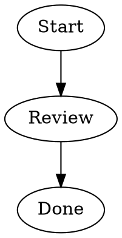

# DOT to diagram

Personal browser extension that detects Graphviz DOT code on webpages and renders SVG diagrams in place using Viz.js.

## Features

- Detects graph and digraph code blocks, including dynamically added page content.
- Renders SVG diagrams locally using bundled Viz.js assets.
- Adapts diagram colors and text contrast to light and dark appearances.

## Install for development

1. Download or clone this repository.
2. Open `chrome://extensions` in a Chromium browser.
3. Enable Developer mode and choose **Load unpacked**.
4. Select this directory, then open a webpage containing a DOT code block.

Example DOT:

## Source

`content.js` handles detection, rendering and themes. `manifest.json` registers a Manifest V3 content script. `viz.js` and `full.render.js` are third-party Viz.js distribution files; their embedded license notices are retained.

## Scope

This is an unpacked development extension, not a published browser-store release. Its content script matches all webpages; narrow site access in the browser's extension settings if desired. Detection depends on page markup and is not guaranteed for every code editor or site.
